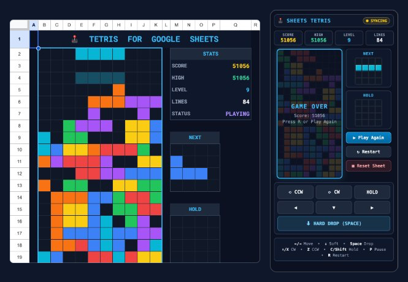
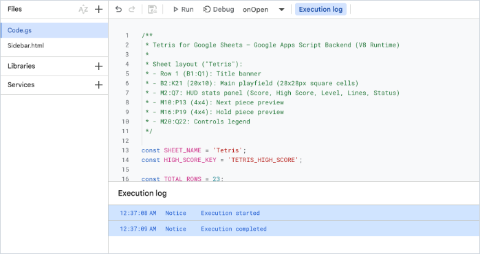

# I built playable Tetris directly inside Google Sheets cells

No external servers, no extensions, no macros to download — just two Google Apps Script files that turn a blank spreadsheet into a playable dark-mode Tetris arcade cabinet.

It renders a full **20×10 playfield directly in Sheet cells (`B2:K21`)** with a live HUD, **4×4 Next and Hold previews**, **ghost piece projection**, **7-bag randomizer**, **SRS rotation with wall kicks**, and a **persistent high score** — all driven by a keyboard-enabled sidebar.



---

## Setup in ~60 seconds

You only need **two files** from the root of this repo:
- [`Code.gs`](Code.gs)
- [`Sidebar.html`](Sidebar.html)

*(Ignore the `src/` folder — that's just the local dev source and unit tests. You don't need to paste anything from `src/` into Apps Script.)*

### 1. Create a blank Sheet
Go to **[sheets.new](https://sheets.new)** and name it **`Tetris for Google Sheets`** (or whatever you like).

### 2. Open Apps Script
In the top menu bar, click **Extensions → Apps Script**.

### 3. Paste `Code.gs`
You'll land inside an empty `Code.gs` file. Select all, delete the default `myFunction() {}`, and paste the full contents of [`Code.gs`](Code.gs).

> **Mac shortcut:**
> ```bash
> pbcopy < Code.gs
> ```
> Then press `Cmd+V` in the editor.

### 4. Add `Sidebar.html`
In the left **Files** panel, click the **`+`** icon → **HTML**, and name it **`Sidebar`** *(exact capitalization — Apps Script adds `.html` automatically, so it shows up as `Sidebar.html`)*.

Delete the starter HTML and paste the full contents of [`Sidebar.html`](Sidebar.html).

> **Mac shortcut:**
> ```bash
> pbcopy < Sidebar.html
> ```
> Then press `Cmd+V` in the editor.

### 5. Save both files
Press **`Cmd+S`** (Mac) or **`Ctrl+S`** (Windows/Linux) and make sure the little orange unsaved dot disappears next to both `Code.gs` and `Sidebar.html`.

### 6. Authorize & Launch (don't get stuck on Google's popup!)

You have two ways to kick it off — **Option A** is the fastest because you're already in the Apps Script tab and don't have to wait for the custom menu to appear.

#### Option A: The Apps Script shortcut (fastest)
1. In the Apps Script toolbar, select **`setupBoard`** from the function dropdown next to **▷ Run**, then click **▷ Run**.



2. The first time you run it, Google will show an unverified-app warning (totally normal — it's your own private script). Click through:
   - **Review permissions** → choose your Google account
   - Click **Advanced** *(bottom-left)*
   - Click **Go to Untitled project (unsafe)** → **Allow**
   - *(Heads up: work/school Google Workspace accounts sometimes block unverified scripts. A personal `@gmail.com` account works best.)*
3. Once the Execution log says `Execution completed`, switch back to your Google Sheet tab — the dark arcade board is already built.
4. Refresh the Sheet tab once to get the **`🕹️ Tetris`** menu at the top, **or** select **`showSidebar`** in the Apps Script dropdown and hit **▷ Run** to pop open the controller sidebar immediately.

#### Option B: From the Sheet menu
1. Reload your Google Sheet tab and wait a few seconds for **`🕹️ Tetris`** to appear in the top menu bar.
2. Click **`🕹️ Tetris` → `Setup / Reset Board`** (approve the same permissions prompt from Option A on first run).
3. Click **`🕹️ Tetris` → `Play Tetris`**.

> **Tip:** Click once inside the sidebar before pressing keys so keyboard focus stays in the game instead of typing into spreadsheet cells.

---

## Controls

| Key | Action |
| :--- | :--- |
| `←` / `→` | Move left / right |
| `↓` | Soft drop |
| `Space` | Hard drop (instant lock) |
| `↑` or `X` | Rotate clockwise (SRS + wall kicks) |
| `Z` | Rotate counter-clockwise |
| `C` or `Shift` | Hold piece |
| `P` | Pause / Resume |
| `R` | Restart |
| `Enter` | Start game (from Ready / Game Over) |

There are also clickable D-pad, Rotate, Drop, and Hold buttons built into the sidebar if you're playing one-handed.

---

## How it doesn't lag Google Sheets to death

Google Sheets isn't exactly a 120Hz game engine, so a few tricks keep it feeling snappy:

- **60fps local mini-canvas in the sidebar:** The entire Tetris engine runs locally in the sidebar iframe, so every keypress, rotation, and hard drop registers with zero latency while the spreadsheet catches up behind it.
- **Coalesced `google.script.run` frames:** Instead of piling up a backlog of RPC calls when you mash keys, the sidebar uses an `inFlight` + `dirty` flag — at most one sync runs at a time, and the moment it finishes, it immediately pushes the latest board state.
- **Batched cell writes:** Every frame paints the entire 20×10 playfield in a single `setBackgrounds()` call, updates the 4×4 Next/Hold previews in two tiny `setBackgrounds()` calls, and writes all HUD stats in one `setValues()` call. Zero cell-by-cell loops.
- **Persistent High Score:** Saved in `PropertiesService.getUserProperties()`, so your best score sticks around across reloads and board resets without needing hidden sheets.

---

### Want to hack on the engine?
The standalone game engine, tests, and sidebar builder live in [`src/`](src/). With Node.js installed, you can run the test suite and rebuild the root [`Sidebar.html`](Sidebar.html):

```bash
node --test src/tetris-core.test.js
node src/build.js
```
